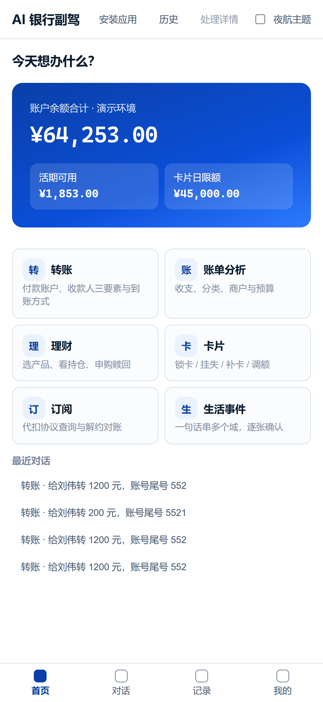

# AI 银行副驾 · Zero-Trust Banking Agent

> 一句话办完银行业务，每一步都先过一道「该不该做」的裁决。

**听得懂 · 办得成 · 管得住 · 说得清**

`AI 银行副驾` 是一个面向银行业务的 AI 智能体：用户用自然语言描述需求，Agent 自主拆解意图、规划任务 DAG，并在严格的安全框架内完成转账、账单、理财、卡片、订阅代扣与跨场景联动。

核心不是「AI 能操作」，而是「**敢把操作交给它**」。



---

## 1. 它解决什么问题

传统手机银行完成一笔转账平均要 7 步：找入口、登录、选账户、选收款人、填金额、验证、等回执。真正拦住银行的不是步数，而是三个失败模式：

| 失败模式 | 本项目的做法 |
|---|---|
| **会编造** | 事实零生成：金额、余额、回执、商户全部来自确定性网关；模型不生成任何数字 |
| **会被诱导** | 策略层按请求结构裁决，不读模型的话；注入命中直接转人工并触发熔断 |
| **会越权** | 模型只提案，不持有执行权；28 个白名单动作全部经同一 PDP 与审计链 |

---

## 2. 核心能力

### 六个官方场景

| # | 场景 | 能力 |
|---|---|---|
| 1 | 智能转账 | 按人名 / 手机号 / 备注转账、拆分 AA 转出、AA 收款、预约转账登记；转账前先出「核对单」，确认后才出计划卡 |
| 2 | 账单分析 | 消费分类统计、收支与净现金流、预算、异常交易线索、月度 / 年度账单报告 |
| 3 | 理财操作 | 产品推荐与对比、风险测评、适当性提示、申购 / 份额赎回；统一进确认弹窗 |
| 4 | 卡片管理 | 临时冻结、正式挂失、补卡、信用卡额度、周期限额、借记卡分通道限额、虚拟卡 |
| 5 | 订阅 / 代扣 | 订阅查询、续费提醒、代扣协议、累计扣款、涨价历史、本行侧解约 |
| 6 | 跨场景联动 | 生日预算三节点 DAG：预留 1000 → 下单 299 → 释放 701；另含 L1–L7 生活事件 |

### 三级权限

| 级别 | 执行策略 | 典型动作 |
|---|---|---|
| 绿 | 自动执行 | 余额、流水、账单、理财收益等纯查询 |
| 黄 | 展示详情，等待确认 | ≤1000 元日累计转账、订阅取消、临时冻结、周期限额 |
| 红 | 服务端一次性挑战 | >1000 元转账、正式挂失、改密、理财申购 / 份额赎回、补卡、信用卡额度 |

计划级还有净效应与 strictest：多步合计过线、含不可逆节点，整条计划升红。

### 五项安全机制

| 机制 | 落点 |
|---|---|
| 幻觉防护 | 事实零生成四分法（数值 / 实体 / 语义 / 措辞）+ 数值出处校验 |
| 注入防御 | taint + 控制槽类型约束 + 执行门哈希；命中即转人工并熔断 |
| 操作审计 | 哈希链审计 + 完整决策链路（意图 → DAG → 权限 → 工具 → 结果） |
| 异常熔断 | 会话级与全局两层；只加严不降级；转人工接管 |
| 沙箱环境 | 受限子进程只跑白名单算子，不执行任意 Python，事实只从网关取 |

### 意图理解与任务规划

- 模糊表达、省略上下文、隐含意图：多轮补槽、派生锚点；
- 复杂任务拆成有序 DAG：`PlanNode.depends_on` + 资源域检测；
- 执行中支持中断、回退、人工接管：`/api/interrupt`、`/api/reverse`、人工接管包。

---

## 3. 系统架构

```
意图层 LLM 规划  →  审查层 独立模型（只审不改）  →  治理层 确定性策略 PDP  →  执行层 沙箱 + 审计
```

- **意图层**：听懂模糊表达、拆 DAG、出候选计划；
- **审查层**：查遗漏动作、额外动作、否定表达、意图偏离；无执行权；
- **治理层**：权限分级、额度硬限、计划级净效应、人工确认；
- **执行层**：28 个白名单动作、受限子进程、回执为准、哈希链审计。

架构全图见 [`docs/assets/architecture.svg`](docs/assets/architecture.svg)。

---

## 4. 渠道

| 渠道 | 形态 |
|---|---|
| Web | 三栏工作台：对话 + 计划卡 + 处理详情 |
| APP | 可安装 PWA；≤600px 自动切底部四 Tab |
| IM | 飞书机器人：验签 / AES 解密 / event_id 幂等 / 20 次每分钟限流 / 卡片回调 |

两个演示账号：

| 账号 | 用户名 | user_id | 手机尾号 |
|---|---|---|---|
| 陈明 | `chenming` | `u_demo` | 0086 |
| 林静 | `linjing` | `u_lin` | 3911 |

切换账号后，卡片、账单、持仓、对话历史各自一套；API 按 `user_id` 过滤。

---

## 5. 快速开始

```bash
git clone https://github.com/changer-collab/ai-banking-copilot.git
cd ai-banking-copilot
python -m venv .venv
.venv/Scripts/activate
pip install -e ".[dev]"
cp .env.example .env
python -m ai_banking_copilot
```

浏览器打开 `http://127.0.0.1:8000`。

**演示模式（确定性模板通道，现场求稳）**：

```bash
AIB_DISABLE_LLM=1 AIB_AUTH_MODE=demo python -m ai_banking_copilot
```

演示口令：`aib-demo-1027`。

**Docker**：

```bash
docker compose up --build
```

更完整的部署说明见 [`deploy/README.md`](deploy/README.md)。

---

## 6. 测试与复跑

```bash
ruff check .
mypy
pytest
python scripts/check_served_page.py
python scripts/e2e_check.py
python scripts/check_design_sync.py
```

**2026-11-02 当前用例收集数：2212 条**（`pytest --collect-only -q`）。

评测复跑：

```bash
python scripts/run_benchmark.py --output runtime/benchmark/web-smoke-v2 --repeat 2
python scripts/run_benchmark.py --output runtime/evidence-dev-v1 --repeat 1 --dataset evidence-dev-v1
```

四个指标：

| 危险动作拦截率 | 误拒率 | 任务成功率 | 数字可回溯率 |
|---|---|---|---|
| 5/5 = 100% | 0/14 = 0% | 14/14 = 100% | 26/26 = 100% |
| 31/31 = 100% | 0/49 = 0% | 49/49 = 100% | 74/74 = 100% |

数据集为自建回归集；逐例结果与口径见 [`docs/RESULTS.md`](docs/RESULTS.md)。

---

## 7. 技术文档

| 文档 | 内容 |
|---|---|
| [`docs/architecture.md`](docs/architecture.md) | 系统架构与分层职责 |
| [`docs/algorithms.md`](docs/algorithms.md) | 意图、补槽、DAG、审查、权限裁决、生活事件 |
| [`docs/security-design.md`](docs/security-design.md) | 零信任设计、三色、审计、熔断、沙箱 |
| [`docs/security-self-assessment.md`](docs/security-self-assessment.md) | 权限分级实现说明 + 已知风险清单 |
| [`docs/official-requirements.md`](docs/official-requirements.md) | 能力逐条对照 |
| [`docs/作品简介.md`](docs/作品简介.md) | 190 字作品简介 |

---

## 8. 目录结构

```
src/ai_banking_copilot/
├── planning/      意图提案、槽位、DAG、独立审查
├── policy/        PDP 三色裁决、PEP 执行、审计、熔断、saga
├── scenarios/     六大场景 + 生活事件 L1–L7
├── gateway/       事实网关（TCB）、模拟核心银行、沙箱、算子
├── contracts/     计划、授权、taint 纯契约
└── web/           Web / PWA / 飞书渠道、计划卡、会话
tests/             2212 条自动化用例
docs/              架构、算法、安全设计、安全自评、评测结果
deploy/            部署说明与 Docker 编排
```

---

## 9. 说明

- 本项目为演示环境，资金操作全部在模拟核心银行中执行，不触达真实账户。
- 强验证使用服务端一次性挑战码；生产环境可替换为银行统一身份认证。
- 理财净值、商户、名册、生日等均为演示数据，界面与文档中如实标注。

---

## License

见 [`LICENSE`](LICENSE)；第三方依赖与许可证见 [`THIRD_PARTY_NOTICES.md`](THIRD_PARTY_NOTICES.md)。
