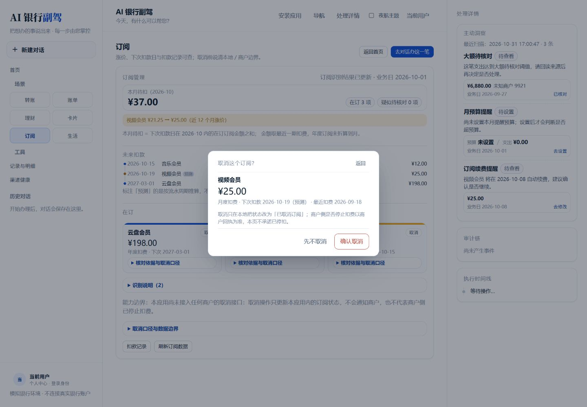
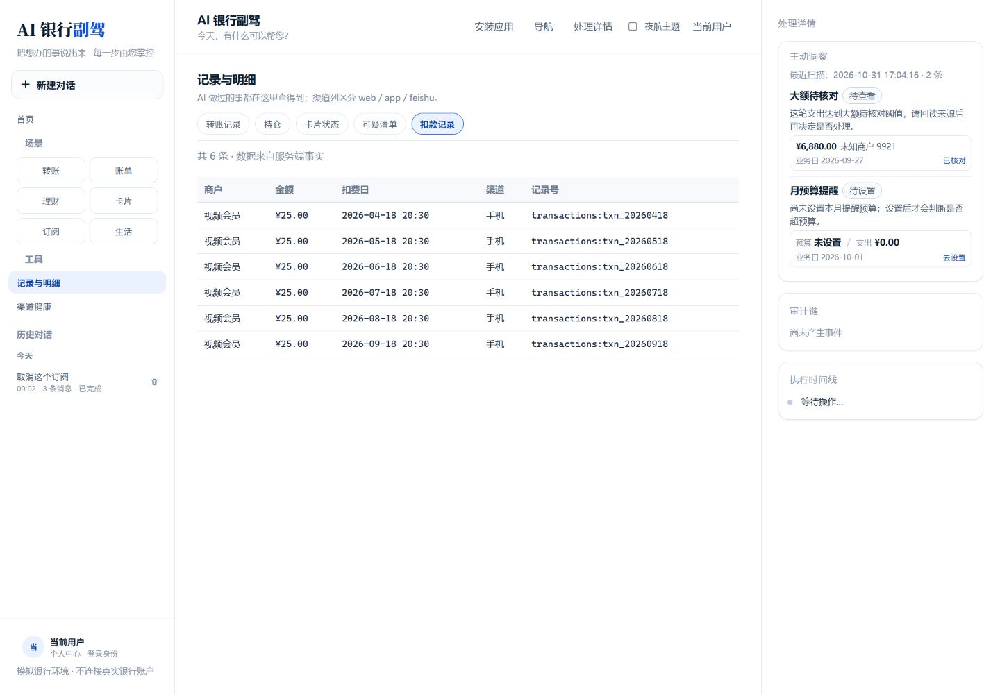
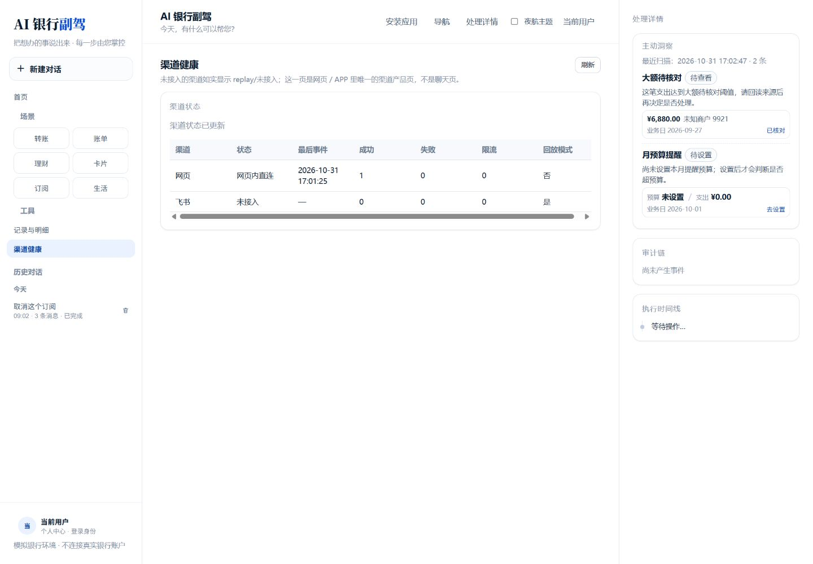
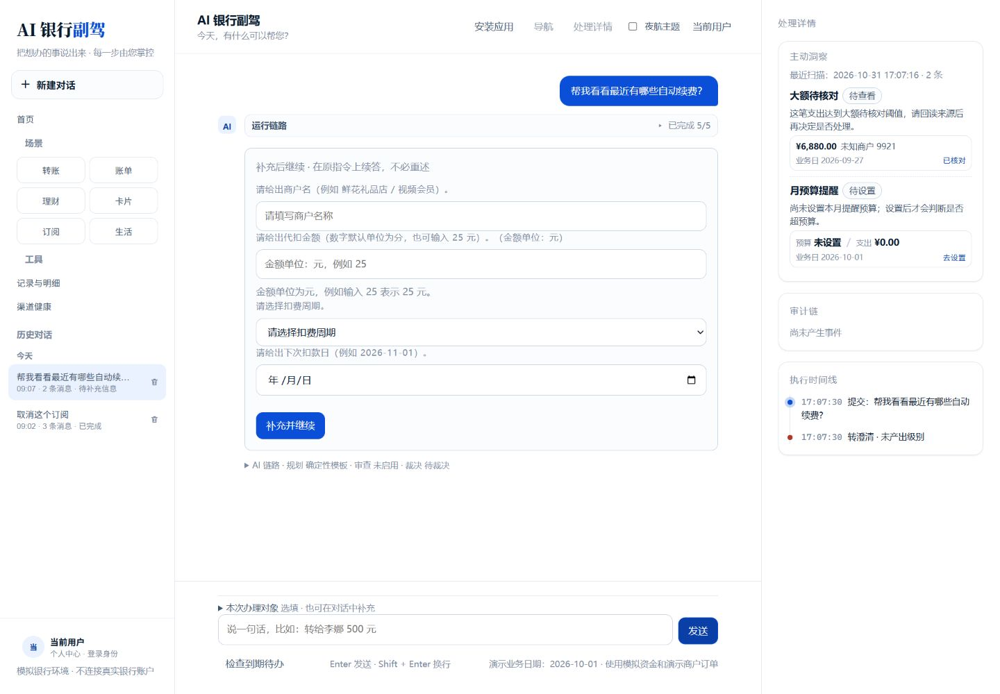
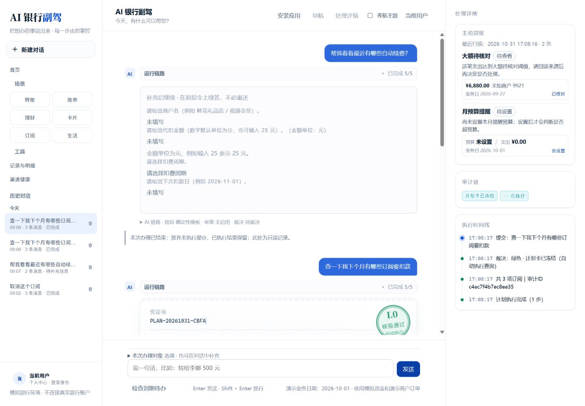
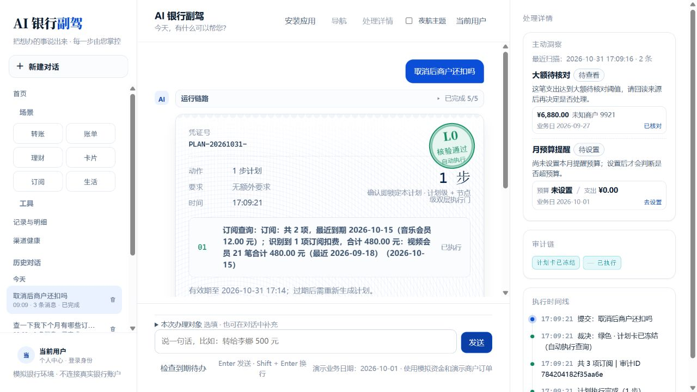
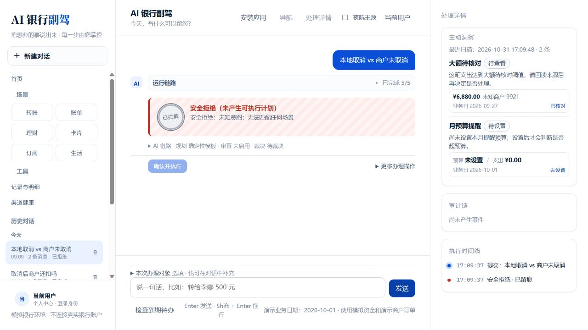
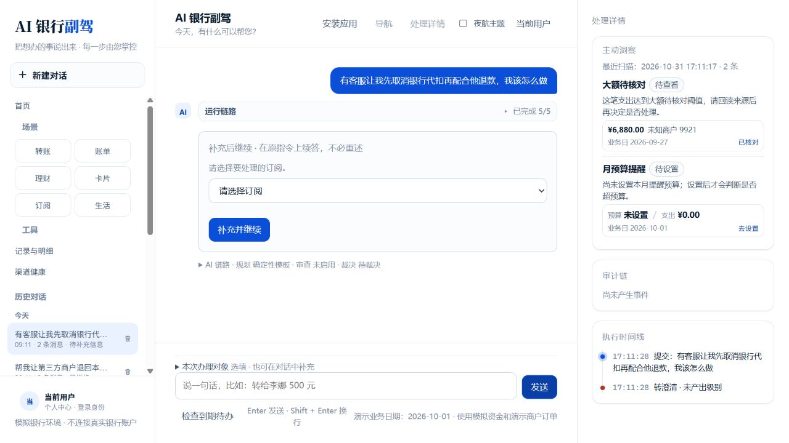
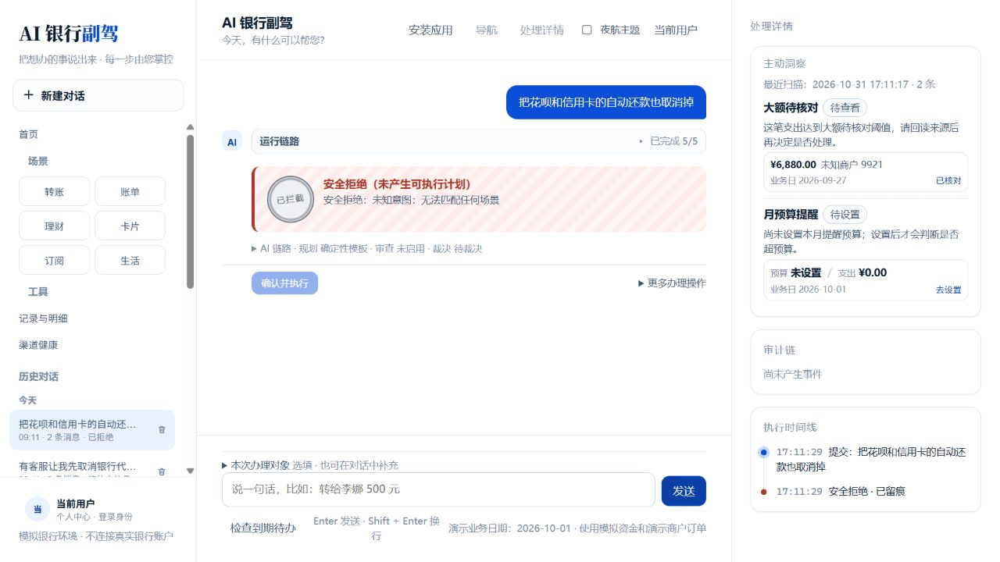
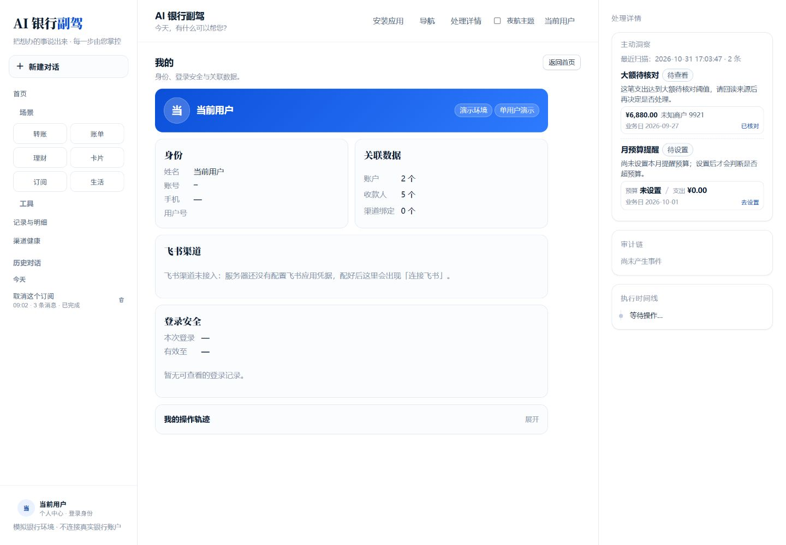

# 订阅与渠道实测问题

以下仅保留实测中发现的问题截图。

## 1. 订阅取消对话框未显示本期扣款状态

取消订阅确认界面展示了商户、金额、周期和日期，但没有明确说明“本期是否已扣”。

## 2. 扣款记录未区分渠道

扣款记录中的渠道显示为“手机”，无法清晰区分 Web、App、飞书等入口。

## 3. 渠道健康页缺少渠道状态

渠道健康页只展示 Web 和飞书，未展示预期的 IM 渠道。

## 4. 自动续费查询被错误识别为新增订阅

“帮我看看最近有哪些自动续费？”被引导填写商户、金额、周期和下次扣款日期，进入了新增订阅流程。

## 5. 下月扣款数量前后不一致

同一回答中出现“共 2 项”和“共 3 项订阅”的数量矛盾。

## 6. 本地取消与商户取消的边界未说明

询问“本地取消 vs 商户未取消”时未能匹配场景，无法说明本地记录取消与商户侧实际取消的区别。

## 7. 反诈提示未给出风险提醒

反诈相关提问被要求选择订阅，没有先给出风险提示或安全建议。

## 8. 还款代扣取消未提示风险

询问取消还款代扣时被识别为未知意图，未提示可能产生逾期或还款失败风险。

## 9. 我的页面渠道状态文案不符合预期

飞书渠道显示为“飞书渠道未接入……”，未按预期展示“未绑定 · replay”等状态信息。

